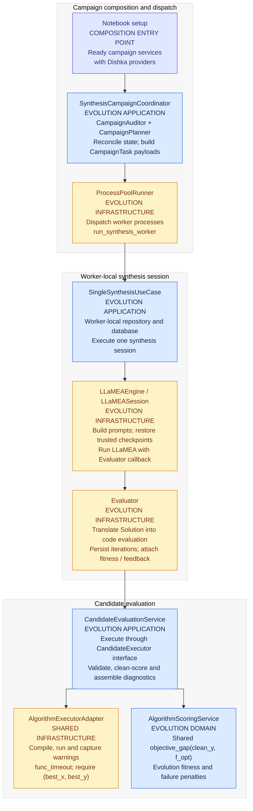
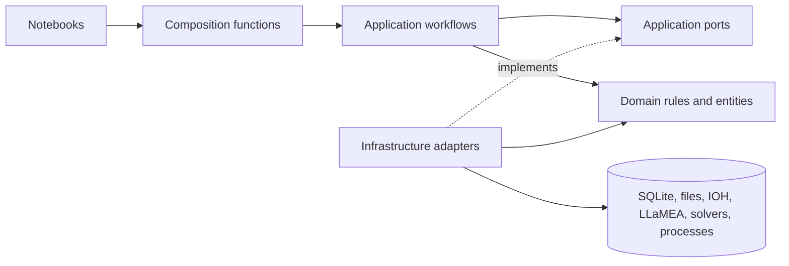

# System architecture

[Documentation map](../README.md) · [Project README](../../README.md)

A modular monolith with two workflow contexts: **evolution** and **benchmarking**.
Audit is a capability within those contexts; notebooks own presentation.

## Workflow overview

[Workflow overview](../../README.md#level-0--workflow-overview) ·
[Detailed system diagram](../../README.md#level-1--detailed-system-view) ·
[Level 0 Mermaid source](system_overview.mmd) ·
[Level 1 Mermaid source](system_diagram.mmd)

## Synthesis collaboration



Arrows show runtime calls/delegation, not permission for core modules to import adapters.
Fitness and feedback return through the Evaluator callback.
Configuration, repositories, problem factory and LLM client are injected collaborators;
they remain visible in the detailed system diagram rather than repeated as separate
nodes in this focused view.

## Dependency direction



Solid arrows describe dependencies/composition; the dashed edge means an adapter
implements an interface. Application code does not import its concrete adapter.

| Owner | Responsibilities |
| --- | --- |
| Evolution | Prompts, campaigns, iterations, feedback, fitness penalties and synthesis recovery. |
| Benchmarking | Champion selection, trial validity/resumption, audit, reliability, ECDF and transfer. |
| Shared foundation | BBOB/noise definitions, objective gap, problem capabilities, execution and database adapters. |
| Notebooks / infrastructure DI | Composition, labels, Plotly figures and explicit exports. |

Neither context's application/domain imports the other context. Shared code imports
neither context. Benchmarking infrastructure may read synthesis records through
read-only adapters; evolution owns synthesis writes. Database sessions are short-lived,
with worker-local engines and the existing SQLite WAL configuration.

[Execution and recovery](execution_flow.md) ·
[Benchmark protocol](../benchmark_protocol.md) ·
[Analysis workflows](../../notebooks/analysis/README.md)

<details>
<summary>Module ownership, persistence and implementation notes</summary>

## Context map and ownership

This is a modular monolith with two workflow contexts, not independent services.

```text
Notebook dashboards / figures / exports
                  ↓ composition in infrastructure DI
        Evolution                 Benchmarking
    synthesis + campaign       selection + evaluation + analysis
                  ↓                    ↓
       Shared scientific rules and runtime infrastructure
```

Evolution owns prompts, generation modes, experiment/iteration semantics, fitness
penalties, and campaign coverage. Benchmarking owns champion ranking, trial
protocols, condition validity, benchmark coverage, reliability, and transfer studies.
Audit and analysis are workflows, not a third bounded context. Persistence and
candidate runtime are supporting infrastructure, not business contexts.

Shared code must not depend on either context. Neither context's domain or
application imports the other context. Bootstrap may compose both. Benchmarking's
read-only SQLite adapters deliberately consume synthesis-owned table projections;
they must not write synthesis state or invoke synthesis workflows. The ORM schema
stays in shared infrastructure for this single-database application; evolution owns
its synthesis-table meaning and writes. Benchmark traces/provenance belong to
benchmarking. No database/schema migration is required.

## Dependency direction

The dependency rule for core code is inward: domain code owns scientific rules
and may use numerical/data-model libraries, but does not depend on infrastructure
or application workflows; application code depends on domain and application
ports; infrastructure depends inward on those contracts and outward on external
libraries. Infrastructure Dishka providers construct concrete adapters; notebooks resolve workflows. The dotted adapter
relationship is runtime wiring, not an import from a port to its implementation.
Shared BBOB metadata, objective-problem capabilities, noise mathematics, and the
objective-gap function live in `shared/domain/`. IOH problem construction,
calibration/lifecycle, SQLite, and guarded candidate execution live in
`shared/infra/`. Synthesis mode and `ProblemProfile` are not problem-adapter
capabilities: evolution constructs the profile and passes the session mode.

## Dependency injection and resource scopes

Dishka bindings live only in infrastructure:

| Provider | Ownership |
| --- | --- |
| [SharedProvider](../../src/shared/infra/di.py) | Process-local SQLAlchemy engine/session factory and shared problem factory |
| [EvolutionProvider](../../src/evolution/infra/di.py) | Synthesis repositories, logging, engine, dispatcher and use cases |
| [BenchmarkProvider](../../src/benchmarking/infra/di.py) | Champion reads/selection, benchmark execution, audit and analytical collaborators |

Providers use `provide(Service)` for ordinary constructor injection. `AnyOf`
binds a concrete adapter and its existing interface to the same scoped instance.
Factories remain only where construction needs settings, callable adapters,
library defaults or resource finalization. The shared session-factory registration
comes from the owned database engine; repositories do not construct their own engines.

This follows the same division of responsibility as .NET's Generic Host without
imitating its builder syntax: the host owns lifetime, providers register bindings,
and the container constructs services using typed constructor parameters. An API
server is not required. Console/job code can compose these same providers directly;
notebook setup cells own their local resource lifetimes.

Existing abstract classes are bound only for external or replaceable boundaries
(repositories, code/trace storage, problem creation, logging and task dispatch).
Pure analytical engines and application use cases stay concrete. Provider factories
request these existing interfaces, so replacing an external adapter does not require
rewriting workflow construction. No interface is generated for every class, and
no project-wide scanning or custom `AddScoped` wrapper is used. Register a normal
service with `provide(Service)`; keep experimental inputs as method arguments.

### Interface ownership

An interface belongs to the layer whose concepts it describes, not automatically
to the application layer because Dishka injects it. Returning a domain object
alone is not sufficient: a trace-loading workflow may also return domain data.

| Owner | Contracts | Reason |
| --- | --- | --- |
| Evolution domain | `domain/interfaces/synthesis_repository.py` | Persists and restores experiment domain objects and iteration state |
| Shared scientific domain | `domain/problem.py`, `domain/interfaces/problem_factory.py` | Defines objective-problem capabilities and creation of scientific problem objects |
| Benchmarking application | `ChampionRepository`, `SynthesisReadRepository` | Query projections/DataFrames and workflow exports; not repositories for benchmark domain aggregates |
| Benchmarking application | `BenchmarkTraceReader`, `BenchmarkStateStore`, `CandidateCodeReader` | Workflow IO, provenance, trace lifecycle and code access |
| Evolution application | `SynthesisEngine`, `SynthesisCodeStore`, `TaskDispatcher`, `DuplicateStorage` | Synthesis execution, source artifacts, dispatch and maintenance workflows |
| Shared application | `CandidateExecutor` | External generated-code execution, warnings and timeout boundary |
| Context application packages | `BaseLogger`, `BenchmarkLoggerInterface` | Workflow telemetry rather than scientific rules |

Concrete adapters remain in infrastructure and implement these contracts. The
domain repository does not expose SQLite WAL checkpointing; that method remains
an internal capability of `SQLiteSynthesisRepository`, with its existing calls
and database behavior unchanged. Domain modules may not import application,
infrastructure or Dishka. No replacement interface was introduced for WAL work.

Notebook-only initialization lives in the notebooks themselves. There are no
backend notebook-host classes or modules. Reusable providers neither import
notebook lifecycle code nor register shutdown hooks.

There is no separate audit context or root bootstrap package. Application and
domain modules neither import Dishka nor resolve dependencies from a container.
They retain ordinary constructor injection and explicit experiment parameters.

The database and caller-owned LLM client have application/process scope.
Repositories, mutable loggers, workload coordinators and analysis use cases have
request/job scope. Analysis settings and worker engines are request context,
not application-global experiment settings. Repositories continue opening
short-lived sessions per operation. WAL, foreign keys, busy timeout and
synchronous settings remain the database adapter's responsibility.

Each notebook's setup cell uses standard-library `ExitStack` to own a Dishka
request/job scope across cells. Setup resolves ready services without executing
their workflow methods. A PID-bound `atexit` callback releases resources at normal
process shutdown; `close_synthesis()`, `close_benchmark()` or `close_analysis()`
releases them early. Rerunning setup unregisters and invokes its previous callback
before replacement. Failed initialization closes partial resources immediately.
The database provider owns engine disposal; LLM clients remain caller-owned.

Use cases receive collaborators through ordinary constructor injection. Dishka
constructs the registered services; notebooks receive those ready-to-use objects
from their setup cells and call their methods normally. No injection
decorators, context-local service locators or container lookups are needed in
notebooks. SQLAlchemy and workflows remain synchronous; process workers supply
concurrency.

```python
# After running the corresponding notebook setup cells:
results = campaign.run_campaign(**synthesis_parameters)

outcomes = workflow.service.run_benchmarks(
    solver_type="champions", **benchmark_parameters
)
audit = workflow.audit.get_audit_data(**benchmark_parameters)

# Optional early release; normal process shutdown also releases resources.
close_synthesis()
close_benchmark()
```

Setup cells manage resource lifetime, not method injection. Collaborators are already
supplied before a service is called. Stable collaborators belong in constructors;
budgets, dimensions and other execution inputs remain explicit method arguments.
Do not use services after closing their resources. Detached data results can outlive
the scope. A failed workflow call leaves the services available for diagnosis or retry; it
does not automatically close the notebook application. Force-killing a process
cannot guarantee Python shutdown hooks. Future HTTP handlers should use framework
lifetimes rather than notebook setup. No workflow method proxies or global service
containers are introduced.

Synthesis workers open their own container inside the worker process, then resolve
`SingleSynthesisUseCase` with the engine already in the unchanged task payload.
No container, database engine or session is serialized into a task. The module-level
worker stays picklable. Detached numerical results remain usable after scope exit.

The scope and generator-finalization mechanisms follow the
[Dishka container documentation](https://dishka.readthedocs.io/en/stable/container/index.html).
Service registration and constructor injection follow the
[Dishka quickstart](https://dishka.readthedocs.io/en/stable/quickstart.html).

### Future FastAPI entry point

FastAPI is not implemented by this change. A future server will assemble the same
`SharedProvider`, `EvolutionProvider` and `BenchmarkProvider` in its composition
root. It must not import notebook setup. Dishka's FastAPI middleware owns
request scopes, and the FastAPI lifespan closes the root container. Handlers
receive ready application services through the official integration; service
constructors and scientific methods do not change.

The current providers and workflows are synchronous. Start with the supported
synchronous integration (`inject_sync` at HTTP handlers), or choose an async
container if future adapters actually require asynchronous resources. Do not run
blocking synthesis/benchmark campaigns directly in an async event loop. Long jobs
need worker/job lifetimes separate from HTTP request lifetimes; never pass request
repositories, sessions or containers into the existing process-pool payload.
Per-request analysis settings can be supplied by an HTTP-specific provider for
`BenchmarkConfig`; the current worker engine context remains process-local.
See [Dishka's FastAPI integration](https://dishka.readthedocs.io/en/stable/integrations/fastapi.html).

## Evolution context (`src/evolution/`)

- `application/campaign/` separates audit, task planning, and campaign dispatch.
  `application/synthesis/` groups the single-session and candidate-evaluation use cases.
- `domain/interfaces/` owns the synthesis experiment repository contract.
  `application/interfaces/` owns engine, logging, code-store, dispatch and maintenance
  contracts. The problem-factory contract belongs to the shared scientific domain;
  isolated execution belongs to shared application.
  Worker functions remain module-level for process pickling.
- `domain/` owns experiment entities, synthesis enums, and `AlgorithmScoringService`
  (fitness and failure classification using the shared objective gap).
- `infra/` adapts SQLite/files, LLaMEA, logging, synthesis telemetry, and multiprocessing.

Notebook 02 uses `evolution.infra.di.synthesis_scope()` to prepare the coordinator,
repositories, problem factory, engine and automatically sized dispatcher. Setup does
not read study configuration files. The notebook supplies flat validated method arguments;
the coordinator builds a fresh planner and configuration for each invocation.
Benchmark composition injects concrete workload and trial-runner objects. Each
invocation passes its validated settings to their methods, without factories or
mutable service configuration. No previous call's settings are retained. See the
[parameter inventory](../configuration/model_configuration.md#explicit-study-parameters).
The module-level worker calls `SingleSynthesisUseCase`; `LLaMEAEngine` implements
the synthesis engine interface and delegates a session to `LLaMEASession`.
Its infrastructure `Evaluator` translates LLaMEA solutions into calls to
`CandidateEvaluationService` and persists iteration telemetry. The shared
`AlgorithmExecutorAdapter` implements the candidate executor interface;
`BBOBProblemFactory` implements the problem factory interface. These are runtime
collaborations, not imports from application code into infrastructure.

For dispatch and checkpoint steps, see [execution and recovery](execution_flow.md).
For scoring and execution limitations, see [evaluation protocol](../benchmark_protocol.md).

Candidate execution is coordinated by the application: shared infrastructure runs
generated Python and captures warnings, while the application measures runtime
and assembles exception diagnostics. Scoring is a
domain policy specific to synthesis; both workflows use the shared objective-gap
calculation without sharing fitness penalties. Use the application
candidate-evaluation service and executor port directly; the domain contains no
generated-code execution.

## Benchmarking context (`src/benchmarking/`)

- `application/benchmark/` separates workload discovery, per-condition trials,
  batch execution, and coverage auditing. `select_champions.py` owns ranking.
- `application/analysis/` contains injected analysis use cases. A shared loader
  reads validated snapshots; profile, reliability, noise-robustness and performance
  use cases call domain engines and return calculated arrays/tables.
  Numerical snapshots and CSV statistics remain separate from figure export.
- `domain/` owns benchmark-independent reliability, ECDF, performance, and statistical
  calculations.
- `infra/` owns SQLite candidate queries and benchmark state, champion JSON and trace
  IO, numerical snapshot storage, code loading, and CMA-ES/DE/PSO adapters. IOH problem
  lifecycle/noise calibration and candidate execution are shared infrastructure.

The notebook composition functions wire concrete problem, execution, solver, and
code-reading adapters. Model-registry TOML loading is infrastructure work; the
domain's `ModelNames` formats names from supplied registry records. Both workflows
use the same shared BBOB function definition. Champion selection policy is
application-owned; repositories return candidate records and persist exports.

## Audit and analysis boundaries

The independent workflow is named `benchmark`: notebook `03_benchmark.ipynb`
uses `BenchmarkWorkflow` from `benchmarking.infra.di.benchmark_scope()`.
The provider composes `BenchmarkService` and its adapters; method parameters
create the validated `BenchmarkConfig`. Configuration
uses `trials_per_condition`, `trial_timeout_seconds` and
`noise_robustness_enabled`; old workflow imports are not forwarding aliases.
Synthesis candidate evaluation and objective-evaluation counts retain their
scientific names. Recorded provenance keys such as `evaluation_schema_version`,
`evaluation_kind` and `evaluations_used` retain their existing serialized format.

Inside `application/benchmark/`, `run.py` coordinates injected workload and trial
collaborators; the infrastructure provider owns their construction. `workload.py` discovers typed
tasks carrying exact selected champions, then projects them into audit tables.
`trials.py` resumes and executes those conditions using one record per terminal
trial rather than parallel mutable columns. `models.py` contains these application
records and callable dependency types. `summary.py` produces read-only outcome
summaries; `audit.py` reports coverage. Scientific validity, trial identities and
outcome calculations remain domain policies; the storage adapter owns native and
transfer directory layouts. Partial histories with incompatible execution versions
are reported consistently by readiness and refused by resumption without deletion;
complete compatible-schema historical results remain reusable.

Notebook 04 passes expected synthesis coverage as plain condition specifications
to `benchmark_scope(planned_conditions=...)`, then calls its ready audit service. The benchmark audit reports missing champions
separately from executable condition completion and reuses the pure status policy
used by workload discovery and trial resumption. Stale schema/hash results expose
recorded counts but contribute zero reusable trials. Native, noise robustness,
implicit/explicit origins, and cross-function conditions never substitute for one
another. Baselines do not require a synthesis champion.

Audit returns numeric IDs, counts, reasons, and statuses. Notebook 04 owns icons,
labels, heatmaps, CSV exports, and the Markdown dashboard. Analysis use cases receive
required loaders and engines through constructor injection.
Notebook analysis setup passes explicit validated settings to
`benchmarking.infra.di.analysis_scope()` and owns resources until explicit close
or normal process shutdown. Application use cases load an
internal snapshot and calculate results without writes. Notebooks receive detached
scientific results and resolved metadata, not live repositories or engine services.
Plotly builders consume those results; `AnalysisFigureExporter` orchestrates PNG
export under `notebooks/analysis/plotting/`, without figure caching.
`infra/storage/analysis_results_store.py` owns numeric persistence, separately composed
by the same provider: compressed arrays, CSV statistics and provenance manifests under
`results/analysis/`, plus established report CSVs. Reloading restores detached
results without database access or calculation. Calculation does not depend on export
requests. Only intermediate numerical results are persisted for reuse, not
Plotly objects or image-export state. Every export call rebuilds and writes PNGs.
Terminal trial completion and available
convergence traces remain distinct: missing traces are not fabricated.

Architecture tests enforce layer direction, context independence, shared-foundation
independence, the absence of backend presentation dependencies, and the absence
of scientific calculation/data-loading calls in figure builders.

## Data and imports

Imports are explicit from the owning layer; compatibility shims are not maintained.
Configuration keys, notebook entry points,
champion JSON shape, traces, and existing experiment data are preserved; this refactor
does not regenerate benchmark results.

Historical synthesis pickle checkpoints use an infrastructure reader that translates
the six relocated scientific/runtime type module names during deserialization.
It preserves pickle state and normal rehydration hooks without restoring obsolete
Python modules or rewriting archives. As before, only trusted local pickle archives
may be loaded; this is not a security sandbox for checkpoint files.

</details>
