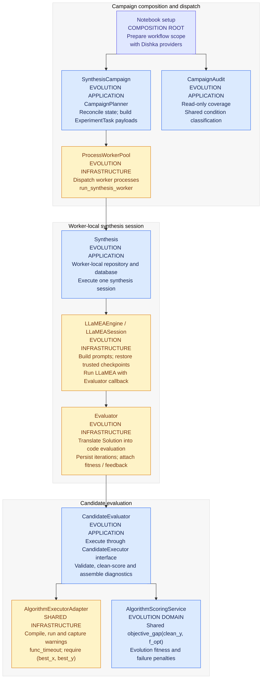
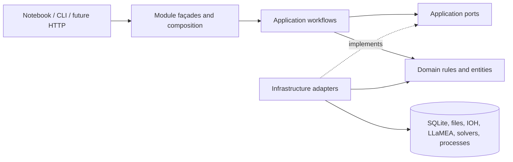

# System architecture

[Documentation map](../README.md) · [Project README](../../README.md)

A modular monolith with two workflow contexts: **evolution** and **benchmark**.
Audit is a capability within those contexts; notebooks own presentation.

## Workflow overview

[Workflow overview](../../README.md#level-0--workflow-overview) ·
[Detailed system diagram](../../README.md#level-1--detailed-system-view) ·
[Level 0 Mermaid source](system_overview.mmd) ·
[Level 1 Mermaid source](system_diagram.mmd)

## Synthesis collaboration



Arrows show runtime calls/delegation, not permission for core modules to import adapters.
Fitness and feedback return through the Evaluator callback.
Configuration, repositories, problem factory and LLM client are injected collaborators;
they remain visible in the detailed system diagram rather than repeated as separate
nodes in this focused view.

## Dependency direction



Solid arrows describe dependencies/composition; the dashed edge means an adapter
implements an interface. Application code does not import its concrete adapter.

| Owner | Responsibilities |
| --- | --- |
| Evolution | Prompts, campaigns, iterations, feedback, fitness penalties and synthesis recovery. |
| Benchmark | Champion selection, trial validity/resumption, audit, reliability, ECDF and transfer. |
| Shared foundation | BBOB/noise definitions, objective gap, problem capabilities, execution and database adapters. |
| Notebooks / infrastructure DI | Composition, labels, Plotly figures and explicit exports. |

Neither context's application/domain imports the other context. Shared code imports
neither context. Benchmark infrastructure may read synthesis records through
read-only adapters; evolution owns synthesis writes. Database sessions are short-lived,
with worker-local engines and the existing SQLite WAL configuration.

[Execution and recovery](execution_flow.md) ·
[Benchmark protocol](../benchmark_protocol.md) ·
[Analysis workflows](../../notebooks/analysis/README.md)

<details>
<summary>Module ownership, persistence and implementation notes</summary>

## Context map and ownership

This is a modular monolith with two workflow contexts, not independent services.

```text
Notebook dashboards / figures / exports
                  ↓ composition in infrastructure DI
        Evolution                 Benchmark
    synthesis + campaign       selection + evaluation + analysis
                  ↓                    ↓
       Shared scientific rules and runtime infrastructure
```

Evolution owns prompts, generation modes, experiment/iteration semantics, fitness
penalties, and campaign coverage. Benchmark owns champion ranking, trial
protocols, condition validity, benchmark coverage, reliability, and transfer studies.
Audit and analysis are workflows, not a third bounded context. Persistence and
candidate runtime are supporting infrastructure, not business contexts.

Shared code must not depend on either context. Neither context's domain or
application imports the other context. Bootstrap may compose both. Benchmark's
read-only SQLite adapters deliberately consume synthesis-owned table projections;
they must not write synthesis state or invoke synthesis workflows. The ORM schema
stays in shared infrastructure for this single-database application; evolution owns
its synthesis-table meaning and writes. Benchmark traces/provenance belong to
benchmark. No database/schema migration is required.

## Dependency direction

The dependency rule for core code is inward: domain code owns scientific rules
and may use numerical/data-model libraries, but does not depend on infrastructure
or application workflows; application code depends on domain and application
ports; infrastructure depends inward on those contracts and outward on external
libraries. Infrastructure Dishka providers construct concrete adapters; notebooks resolve workflows. The dotted adapter
relationship is runtime wiring, not an import from a port to its implementation.
Shared BBOB metadata, objective-problem capabilities, noise mathematics, and the
objective-gap function live in `shared/domain/`. IOH problem construction,
calibration/lifecycle, SQLite, and guarded candidate execution live in
`shared/infra/`. Synthesis mode and `ProblemProfile` are not problem-adapter
capabilities: evolution constructs the profile and passes the session mode.

## Dependency injection and resource scopes

Dishka bindings live only in infrastructure:

| Provider | Ownership |
| --- | --- |
| [SharedProvider](../../src/shared/infra/di.py) | Process-local SQLAlchemy engine/session factory and shared problem factory |
| [EvolutionProvider](../../src/evolution/infra/di.py) | Synthesis repositories, logging, engine, dispatcher and use cases |
| [BenchmarkProvider](../../src/benchmark/infra/di.py) | Champion reads/selection, benchmark execution, audit and analytical collaborators |

Providers use `provide(Service)` for ordinary constructor injection. `AnyOf`
binds a concrete adapter and its existing interface to the same scoped instance.
Factories remain only where construction needs settings, callable adapters,
library defaults or resource finalization. The shared session-factory registration
comes from the owned database engine; repositories do not construct their own engines.

This follows the same division of responsibility as .NET's Generic Host without
imitating its builder syntax: the host owns lifetime, providers register bindings,
and the container constructs services using typed constructor parameters. An API
server is not required. Console/job code can compose these same providers directly;
the delivery host owns container startup, workflow/request scopes and shutdown.

Existing abstract classes are bound only for external or replaceable boundaries
(repositories, code/trace storage, problem creation, logging and task dispatch).
Pure analytical engines and application use cases stay concrete. Provider factories
request these existing interfaces, so replacing an external adapter does not require
rewriting workflow construction. No interface is generated for every class, and
no project-wide scanning or custom `AddScoped` wrapper is used. Register a normal
service with `provide(Service)`; keep experimental inputs as method arguments.

### Interface ownership

An interface belongs to the layer whose concepts it describes, not automatically
to the application layer because Dishka injects it. Returning a domain object
alone is not sufficient: a trace-loading workflow may also return domain data.

| Owner | Contracts | Reason |
| --- | --- | --- |
| Evolution domain | `domain/interfaces/synthesis_repository.py` | Persists and restores experiment domain objects and iteration state |
| Evolution domain | `domain/interfaces/code_repository.py` | Persists generated code under its experiment and iteration; returns a stored reference |
| Shared scientific domain | `domain/problem.py`, `domain/interfaces/problem_factory.py` | Defines objective-problem capabilities and creation of scientific problem objects |
| Benchmark application | `ChampionRepository`, `SynthesisReadRepository` | Query projections/DataFrames and workflow exports; not repositories for benchmark domain aggregates |
| Benchmark application | `BenchmarkTraceReader`, `BenchmarkStateStore`, `CandidateCodeReader` | Workflow IO, provenance, trace lifecycle and code access |
| Evolution application | `SynthesisEngine`, `ExperimentWorkerPool`, `DuplicateStorage` | Synthesis execution, dispatch and maintenance workflows |
| Shared application | `CandidateExecutor` | External generated-code execution, warnings and timeout boundary |
| Context application packages | `BaseLogger`, `BenchmarkLoggerInterface` | Workflow telemetry rather than scientific rules |

Concrete adapters remain in infrastructure and implement these contracts. The
domain repository does not expose SQLite WAL checkpointing; that method remains
an internal capability of `SQLiteSynthesisRepository`, with its existing calls
and database behavior unchanged. Domain modules may not import application,
infrastructure or Dishka. No replacement interface was introduced for WAL work.

Both `SynthesisCampaign` and `Synthesis` receive `SynthesisEngine`; the connected
model identity comes from that engine. `LLaMEAEngine` is its registered adapter,
not a second workflow contract. The domain-owned `CodeRepository` covers synthesis
writes and experiment cleanup; `FileCodeRepository` implements it using files.
The domain receives string references and performs no filesystem operations.
Scientific invariants remain in domain objects and scoring rules; repositories
provide persistence rather than replacing those rules.

For a single non-persistent experiment, `TransientEvolutionProvider` resolves the
same `Synthesis` use case and LLaMEA engine with `MemorySynthesisRepository` and
`MemoryCodeRepository`. Required collaborators remain explicit; repositories are
not omitted or replaced by console output. Experiment history, scoring and
champion selection still work normally in memory. Checkpoint storage is an
explicit engine dependency: the normal provider uses `data/evolution_state`,
while the transient provider owns an isolated temporary directory and removes it
when its scope closes, including after a failure. No research database is opened.
Operational logs and gateway throttle state are separate and remain available.
Transient IDs are local memory identifiers, not SQLite experiment IDs; this mode
supports a sequential single experiment, not campaign recovery across processes.
The returned result retains the champion's code after the scope closes.

Benchmark code reads use `CandidateCodeReader` in their own
context. `DuplicateStorage` is used only by the optional, manually invoked
duplicate-cleanup workflow, never by campaign scheduling or benchmarking.

### Application entry points and lifetimes

Application use cases are the public runtime APIs. Dishka constructs their
constructor dependencies through context-owned providers; no module façade
repeats their method signatures. Application and domain code do not access
containers or injection decorators.

Notebook setup opens a workflow scope and resolves the services needed by that
notebook once. Subsequent cells call those ready services directly. Synthesis and
benchmark calls list their study settings as explicit keyword arguments, shown in
[notebook 02](../../notebooks/02_synthesis.ipynb) and
[notebook 03](../../notebooks/03_benchmark.ipynb). Analysis follows the same pattern:

```python
outcome = profile_analysis.execute(
    mode="explicit", dims=[2], problems=None, noise_stds=[0.1]
)
if outcome.is_success:
    profiles = outcome.value
    results_exporter.save(profiles)
else:
    print(outcome.error.message)
```

Public workflow methods return `Result[T]`, with calculated data or a structured
application error. Internal collaborators keep raising failures; the application
reports once and converts the terminal workflow failure to a Result. No command
bus, service locator or generic handler wrapper is introduced. Original causes
remain internal and are excluded from response serialization.

The database engine/session factory and provider-owned LLM client have APP/process
scope. Repositories, mutable loggers and use cases have REQUEST scope, held for
the notebook workflow. This is not a fresh scope per method call. Repositories
still open short-lived database sessions for their operations. Analysis settings
are supplied as a validated `BenchmarkConfig` in setup; execution methods retain
their explicit study parameters. Recreate setup when changing analysis settings,
an imported database or infrastructure configuration.

The shared infrastructure `WorkflowScope` owns cleanup of the Dishka scope and
root. Notebook setup closes the previous scope before replacing it:

```python
from shared.infra.lifecycle import WorkflowScope

if "services" in globals():
    services.close()
services = WorkflowScope(
    EvolutionProvider(), context={}, request_context={}
)
campaign = services.get(SynthesisCampaign)
```

`WorkflowScope` registers normal-process shutdown cleanup, closes resources if
service construction fails and rejects resolution after closure or from another
process. Its cleanup is idempotent and checks the owning process ID, so forked
workers do not finalize parent resources. No cleanup callbacks, ExitStack or
partial functions are needed in notebook cells. Force-killing a process cannot
guarantee finalization. `EvolutionProvider` creates the LLM client from environment
settings and closes its network connection when the root closes. Explicitly
supplied context overrides remain caller-owned. WAL, foreign keys,
busy timeout and synchronous settings remain the database adapter's responsibility.

Synthesis workers open their own container inside the worker process and resolve
`Synthesis` with the engine from the unchanged task payload. No
container, database engine or session is serialized into a task. The module-level
worker stays picklable. Calculated arrays and tables are detached and remain
usable after scope exit; live services must only be used while their scope is open.

Campaign and standalone session entry points are both resolved through the same
provider. The worker-specific binding reuses its supplied engine and opens no
additional LLM client. See [the two workflow APIs](execution_flow.md#two-application-workflows)
for single-session parameters and the application file layout.

Registration, constructor injection and generator finalization follow the
[Dishka quickstart](https://dishka.readthedocs.io/en/stable/quickstart.html) and
[container documentation](https://dishka.readthedocs.io/en/stable/container/index.html).

### Future FastAPI entry point

FastAPI is not implemented by this change. A future server assembles the same
providers once in its host composition root, calls `setup_dishka(container, app)`,
and closes the root during application shutdown. Dishka's FastAPI integration
opens and closes request scopes and injects ready application services into HTTP
handlers. Handlers do not construct services or call container.get.

For the existing synchronous container, a handler uses native `inject_sync`
and `FromDishka`:

```python
from dishka.integrations.fastapi import FromDishka, inject_sync

@router.post("/synthesis")
@inject_sync
def run_synthesis(
    body: SynthesisBody,
    campaign: FromDishka[SynthesisCampaign],
):
    return campaign.run(**body.model_dump())
```

This is an illustrative transport adapter: `router` and `SynthesisBody` belong
to the future server, not current backend APIs. The decorator belongs at the
delivery boundary; constructor injection remains ordinary Python inside use cases.
No custom injection mechanism or mediator is required.

Keep blocking work in synchronous handlers or dedicated jobs. Long campaigns
need job lifetimes independent of HTTP requests; a future submission endpoint
should enqueue work rather than hold a request open. Never pass request-scoped
repositories, sessions or containers into process-pool payloads. Use async
containers only when adapters need asynchronous lifetimes. See
[Dishka's FastAPI integration](https://dishka.readthedocs.io/en/stable/integrations/fastapi.html).

## Evolution context (`src/evolution/`)

- `application/campaign/` separates audit, task planning, and campaign dispatch.
  `application/synthesis/` groups the single-session and candidate-evaluation use cases.
- `domain/interfaces/` owns synthesis experiment and generated-code repository contracts.
  `application/interfaces/` owns engine, logging, worker-pool and maintenance
  contracts. The problem-factory contract belongs to the shared scientific domain;
  isolated execution belongs to shared application.
  Worker functions remain module-level for process pickling.
- `domain/` owns experiment entities, synthesis enums, and `AlgorithmScoringService`
  (fitness and failure classification using the shared objective gap).
- `infra/` adapts SQLite/files, LLaMEA, logging, synthesis telemetry, and multiprocessing.

Notebook 02 calls `SynthesisCampaign` directly; setup resolves the
coordinator, repositories, problem factory, engine and automatically sized worker pool. Setup does
not read study configuration files. The notebook supplies flat validated method arguments;
the coordinator builds a fresh planner and configuration for each invocation.
Benchmark composition injects concrete workload and trial-runner objects. Each
invocation passes its validated settings to their methods, without factories or
mutable service configuration. No previous call's settings are retained. See the
[parameter inventory](../configuration/model_configuration.md#explicit-study-parameters).
The module-level worker calls `Synthesis`; `LLaMEAEngine` implements
the synthesis engine interface and delegates a session to `LLaMEASession`.
Its infrastructure `Evaluator` translates LLaMEA solutions into calls to
`CandidateEvaluator` and persists iteration telemetry. The shared
`AlgorithmExecutorAdapter` implements the candidate executor interface;
`BBOBProblemFactory` implements the problem factory interface. These are runtime
collaborations, not imports from application code into infrastructure.

For dispatch and checkpoint steps, see [execution and recovery](execution_flow.md).
For scoring and execution limitations, see [evaluation protocol](../benchmark_protocol.md).

Candidate execution is coordinated by the application: shared infrastructure runs
generated Python and captures warnings, while the application measures runtime
and assembles exception diagnostics. Scoring is a
domain policy specific to synthesis; both workflows use the shared objective-gap
calculation without sharing fitness penalties. Use the application
candidate-evaluation service and executor port directly; the domain contains no
generated-code execution.

## Benchmark context (`src/benchmark/`)

- `application/trials/` separates workload discovery, per-condition trials,
  batch execution, and coverage auditing. `select_champions.py` owns ranking.
- `application/analysis/` contains injected analysis use cases. A shared loader
  reads validated snapshots; profile, reliability, noise-robustness and performance
  use cases call domain engines and return calculated arrays/tables.
  Numerical snapshots and CSV statistics remain separate from figure export.
- `domain/` owns benchmark-independent reliability, ECDF, performance, and statistical
  calculations.
- `infra/` owns SQLite candidate queries and benchmark state, champion JSON and trace
  IO, numerical snapshot storage, code loading, and CMA-ES/DE/PSO adapters. IOH problem
  lifecycle/noise calibration and candidate execution are shared infrastructure.

The infrastructure providers wire concrete problem, execution, solver, and
code-reading adapters. Model names come directly from the synthesis database and
recorded benchmark provenance; no model registry or slug resolver is involved. Both workflows
use the same shared BBOB function definition. Champion selection policy is
application-owned; repositories return candidate records and persist exports.

## Domain invariants and scientific results

Evolution validates problem IDs, dimensions, instances, noise and declared execution
limits in domain models. `Experiment` always represents a registered database
record: its positive ID is required and immutable. SQLite allocates the ID inside
the creation transaction, the domain validates the record, and only then is the
transaction committed. Invalid input rolls back; no temporary entity with a null
or invented ID is created. The start timestamp is a string, with a default for new
objects and the stored value for hydrated records. The evaluator receives the
experiment as a required dependency. Optional terminal results, finish timestamps
and unknown historical metadata retain their absence semantics. Experiment lifecycle changes use `complete()` or `fail()`;
terminal states cannot be reopened by those methods. Explicit replacement remains
an application operation. Historical unknown budgets, iteration limits and seeds
remain optional; creating new persisted experiments requires explicit budgets and
iteration limits. Repository queries use one keyword-only filter API, rather than
a second criteria-object API with conflicting filters.

The synthesis incumbent is the first candidate with the lowest finite clean error,
matching the existing evolutionary selection behavior. Summary logging reads that
incumbent from domain records. Benchmark champion selection retains its independent
error/evaluation-count ordering; this refactor does not change selected champions.

Benchmark condition identity normalizes noise once to nine decimal places before
value equality and hashing. `RunTrace` rejects mismatched, multidimensional or
unordered checkpoint arrays and exposes detached read-only arrays. A
`BenchmarkDataset` is a mutable collection of those traces, not a frozen value
object. Filtering creates separate containers while safely sharing read-only traces.

ECDF, convergence, success rates, bootstrap intervals and statistical tests remain
in the Benchmark domain. No observations produce unavailable values (`NaN`), while
recorded failed executions remain unsuccessful observations in the denominator.
Search attainment and returned-solution success remain separate measures. The
single `search_success_rate` function supports search-based comparisons; terminal
condition tables use recorded returned-solution errors. Unused trace-based terminal
tables, checkpoint-table APIs and the unused solver-run wrapper were removed.

Statistical comparisons receive explicit `SolverKind` metadata rather than guessing
origin from display labels. Model IDs retain their exact recorded spelling;
small presentation helpers format only solver/strategy and baseline labels. Shared scientific code validates the
returned point and computes finite clean objective gaps for both contexts.
New figure directories also use the model ID directly, without duplicate folder
maps in scientific results. Numerical snapshot format 2 omits those maps; the
reader still accepts format 1 snapshots without altering their statistics.
Benchmark data and derived statistics retain candidate/protocol provenance; ECDF
and other derived statistics are not added to synthesis database tables.

## Audit and analysis boundaries

The independent workflow is named `benchmark`: notebook `03_benchmark.ipynb`
calls `BenchmarkCoordinator` directly, resolved once during setup.
The provider composes `BenchmarkCoordinator` and its adapters; method parameters
create the validated `BenchmarkConfig`. Configuration
uses `trials_per_condition`, `trial_timeout_seconds` and
`noise_robustness_enabled`; old workflow imports are not forwarding aliases.
Synthesis candidate evaluation and objective-evaluation counts retain their
scientific names. Recorded provenance keys such as `evaluation_schema_version`,
`evaluation_kind` and `evaluations_used` retain their existing serialized format.

Inside `application/trials/`, `coordinator.py` coordinates injected workload and trial
collaborators; the infrastructure provider owns their construction. `workload.py` discovers typed
tasks carrying exact selected champions, then projects them into audit tables.
`runner.py` resumes and executes those conditions using one record per terminal
trial rather than parallel mutable columns. `models.py` contains these application
records and callable dependency types. `summary.py` produces read-only outcome
summaries; `audit.py` reports coverage. Scientific validity, trial identities and
outcome calculations remain domain policies; the storage adapter owns native and
transfer directory layouts. Partial histories with incompatible execution versions
are reported consistently by readiness and refused by resumption without deletion;
complete compatible-schema historical results remain reusable.

Notebook 04 passes expected synthesis coverage as plain condition specifications
to `BenchmarkProvider(planned_conditions=...)`, then resolves
`BenchmarkAuditService` and calls `get_audit_data()`. The benchmark audit reports missing champions
separately from executable condition completion and reuses the pure status policy
used by workload discovery and trial resumption. Stale schema/hash results expose
recorded counts but contribute zero reusable trials. Native, noise robustness,
implicit/explicit origins, and cross-function conditions never substitute for one
another. Baselines do not require a synthesis champion.

Audit returns numeric IDs, counts, reasons, and statuses. Notebook 04 owns icons,
labels, heatmaps, CSV exports, and the Markdown dashboard. Analysis use cases receive
required loaders and engines through constructor injection.
Analysis notebooks supply scientific settings during setup and call the four
analysis use cases directly through `execute(...)`. Application use cases load an
internal snapshot and calculate results without writes. Notebooks receive detached
scientific results and resolved metadata, not live repositories or engine services.
Plotly builders consume those results; `AnalysisFigureExporter` orchestrates PNG
export under `notebooks/analysis/plotting/`, without figure caching.
`infra/storage/analysis_results_store.py` owns numeric persistence, separately composed
by the same provider: compressed arrays, CSV statistics and provenance manifests under
`results/analysis/`, plus established report CSVs. Reloading restores detached
results without database access or calculation. Calculation does not depend on export
requests. Only intermediate numerical results are persisted for reuse, not
Plotly objects or image-export state. Every export call rebuilds and writes PNGs.
Terminal trial completion and available
convergence traces remain distinct: missing traces are not fabricated.

Architecture tests enforce layer direction, context independence, shared-foundation
independence, the absence of backend presentation dependencies, and the absence
of scientific calculation/data-loading calls in figure builders.

## Data and imports

Operational errors use application-owned contracts at external boundaries.
Domain services do not configure logging or perform IO. Notebook hosts own
logging lifetimes and output destinations; application methods report failures and pool workers send diagnostic records to
the parent rather than configuring file handlers. See
[error handling and logs](../operations/error_handling_and_logging.md).

Imports are explicit from the owning layer; compatibility shims are not maintained.
Configuration keys, notebook entry points,
champion JSON shape, traces, and existing experiment data are preserved; this refactor
does not regenerate benchmark results.

Historical synthesis pickle checkpoints use an infrastructure reader that translates
the six relocated scientific/runtime type module names during deserialization.
It preserves pickle state and normal rehydration hooks without restoring obsolete
Python modules or rewriting archives. As before, only trusted local pickle archives
may be loaded; this is not a security sandbox for checkpoint files.

</details>
