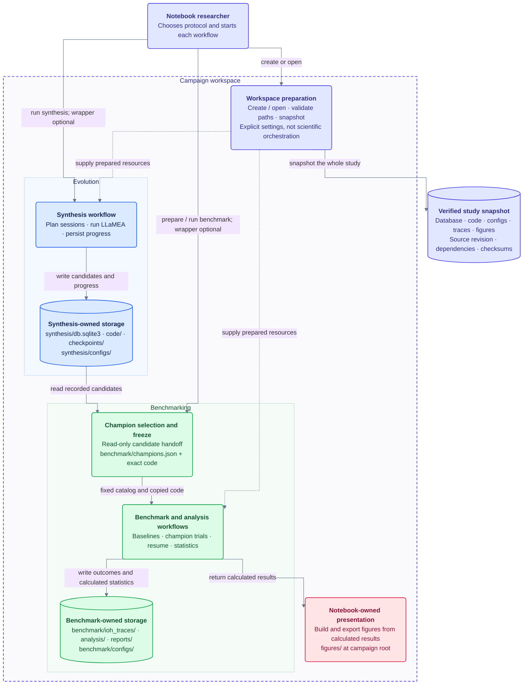
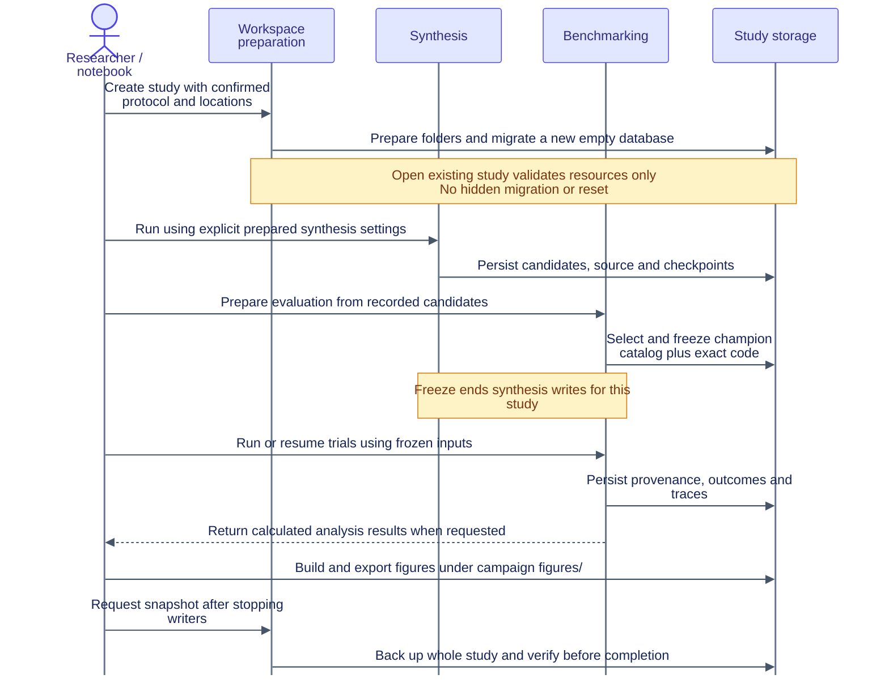

# Campaign isolation and preservation

Status: **Deferred—not implemented**. This is a future design proposal, not a
description of the current application. Updated 21 October 2026.

The diagrams below describe the **deferred target design**, not features available
today. For current implementation, see the [architecture guide](../architecture/system_architecture.md).

- [Immediate research workflow](#immediate-research-workflow)
- [Proposed system overview](#proposed-system-overview)
- [Proposed campaign storage](#proposed-campaign-storage)
- [Preparation and execution sequence](#preparation-and-execution-sequence)
- [Development isolation](#development-isolation-also-deferred)
- [Future migration and verification](#future-migration-and-verification)

## Immediate research workflow

Keep the existing application and manually preserve each study before changing
its protocol. Do not implement campaign management, change scientific settings,
or launch experiments as part of this documentation/preservation task.

1. Stop synthesis, evaluation, analysis/export and maintenance writers. Check the
   machine actually running the experiments; a local process check cannot check
   a remote Jupyter server.
2. Make a consistent SQLite backup and copy generated code, checkpoints, results,
   statistics, reports, figures and configurations into a new archive directory.
   Exclude older archives from the copy; never overwrite or move them.
3. Record the source revision, working-tree changes, dependency versions and
   file checksums. Verify the backup's integrity and every copied artifact before
   marking the archive complete. Keep secrets out of archives.
4. Prepare a separate empty study directory, with a fresh database initialized
   using existing Alembic migrations. This does not migrate the active database
   or require a new schema revision.
5. Keep that directory **inactive** until the protocol is confirmed and a manual
   cutover is planned. Current bootstraps still resolve several paths globally;
   setting only `DATABASE_URL` does not isolate generated code or benchmark data.
6. At cutover, stop all processes, preserve the old active directories intact,
   install the fresh database/code/checkpoint/result directories at the current
   supported paths and restart notebook kernels. Verify every resolved path and
   that no old champions or results are discovered before running. Do not merge
   directories or use `force_rerun` against the archived study.

Archives are ignored by Git. A local archive protects against accidental changes,
not disk loss; copy verified archives to separate storage as well. Keep the latest
fully verified snapshot. Delete superseded snapshots only on explicit request,
after checking the retained snapshot's checksums and database integrity.

As of 22 October 2026, the retained archive is
`results/archives/2026-10-22_154910_before_instance_pilot_A/`. Older snapshots were removed
on request. Separate empty storage was prepared at
`results/studies/2026-10-21_093547_pending_protocol/`; it is **inactive** and does
not implement the campaign layout below. The active application's configurations
and storage paths have not been switched.

### Next protocol: pending confirmation

Budget and dimensions have now been configured independently of the deferred
architecture work. Instance-policy changes remain **pending confirmation**:

| Item | Proposal / outstanding decision |
| --- | --- |
| Evaluation budget | Configured: same fixed 100,000 objective calls per optimizer execution in synthesis and benchmarking |
| Dimensions | Configured synthesis matrix: 2, 10 and 50 |
| Synthesis instances | Multiple instances; exact schedule and candidate-comparison policy undecided |
| Benchmark instances | A disjoint held-out instance set; exact IDs and sampling policy undecided |

Do not silently rotate one instance per synthesis iteration. Incumbents and new
candidates must be compared on comparable measurements; changing their instance
without reevaluation can change selection unfairly. Confirm the training panel,
evaluation policy, seeds, held-out instances and budget accounting with the
professor before changing instance behavior or rerunning anything. Other settings,
including timeouts and statistical parameters, remain unchanged unless explicitly
agreed. Reference configuration copies in a prepared study describe the **old**
protocol, not approval of a new protocol.

## Deferred ownership and composition

- **Evolution** owns synthesis campaigns/sessions, prompting, generated
  iterations, feedback, selection fitness, penalties and stagnation policy.
- **Benchmarking** owns champion selection, benchmark/resumption, provenance,
  reliability, ECDF, performance and generalization analysis.
- **Shared infrastructure/science** owns database connections, common BBOB/noise
  capabilities, objective-gap rules and isolated candidate execution.
- A small **campaign workspace/composition layer** prepares and supplies resources
  to both workflows. It is not a new scientific domain or an orchestrator that
  absorbs synthesis and benchmarking responsibilities.
- Notebooks remain presentation/entry points. Existing mathematical rules and
  execution behavior must not change during the future storage migration.

Synthesis and benchmarking remain independently usable with explicit prepared
database, configuration, code and result locations. Campaign management is an
optional convenience wrapper; application use cases do not require a campaign
object, service locator or generic dependency-injection container.

## Proposed system overview

This is a workflow and resource-ownership view, not a Python import graph or a
claim of strict C4 compliance. The outer campaign boundary groups one study's
resources; it does not merge the two application contexts.



Blue denotes synthesis, green benchmarking, lavender workspace/supporting resources,
and rose notebook presentation. Solid arrows show actions/data handoffs; dashed
arrows show resource injection, **not automatic execution**.

The snapshot arrow covers everything inside the campaign boundary, including
notebook-exported figures. The SQLite database remains synthesis-owned;
benchmarking does not write trial outcomes into it. Benchmarking accesses candidate
records through a read-only projection, never by calling synthesis workflows.
Champion selection and freezing are benchmarking responsibilities.

Standalone use means a caller supplies the same prepared resource settings directly
to either component, without using the workspace convenience layer. It does not
mean skipping database initialization, provenance validation or code freezing.
Benchmarking can use an already frozen catalog/code bundle and run its configured
baselines without starting synthesis. A shared study identifier correlates
artifacts; it does not introduce cross-context application imports.

## Proposed campaign storage

One physical SQLite database belongs to one research study, shared by its models
and sessions, not one database per candidate, trial or model. A study has one
paired synthesis/benchmark protocol. Changing that protocol creates another study.

```text
results/campaigns/<campaign-id>/
  manifest.json
  synthesis/
    configs/synthesis.toml
    db.sqlite3
    code/
    checkpoints/
  benchmark/
    configs/benchmark.toml
    champions.json
    code/
    ioh_traces/
    analysis/
    reports/
  figures/
```

Keep figures outside `benchmark/`; each workflow owns its configuration copies.
Capture resolved model identity/registry metadata without provider credentials.
Snapshot the whole study, not just evaluation traces. Record the code revision,
dependency versions, dates, protocol, hashes and archive format version.

### Preparation and execution

- Explicit creation initializes a new empty database with the existing migration
  chain. Opening an existing workspace validates it and never silently creates,
  upgrades or resets its database. Synthesis does not perform hidden migrations.
- Bootstrap passes concrete resource settings through repositories, executors,
  trace stores and module-level multiprocessing task payloads. Preserve worker
  picklability and current session/WAL settings.
- First evaluation preparation freezes the selected champion catalog and copies
  its exact code. Later benchmark/resumption uses this catalog, not a fresh
  selection from a changing synthesis database.
- Once champions are frozen, reject synthesis writes through that study's
  supported entry points. New synthesis/champions require a new study. Standalone
  workflows must preserve the same explicit inputs and provenance guarantees.
- Keep one active study per workspace initially. No new campaign tables, schema
  relocation, frontend, distributed queue or remote database redesign is needed.

### Preparation and execution sequence

Creation is the explicit preparation step. Opening a study selects and validates
existing resources; neither action starts synthesis or benchmarking. The researcher
decides which workflow to run and when. The following is a **proposed interaction**,
not a runnable API or the current manual staging procedure.



Operations remain distinct:

| Operation | Responsibility | Must not do |
| --- | --- | --- |
| Create | Provision a new, separate workspace and apply existing schema migrations to its empty database | Reuse an existing destination or launch experiments |
| Open | Validate the selected workspace, protocol and resource paths | Initialize missing storage or silently migrate/reset it |
| Run synthesis | Call evolution with explicitly supplied resources | Prepare another database or write into a frozen study |
| Prepare evaluation | Select champions and freeze catalog/code once | Change ranking mathematics or silently reselect on resume |
| Run evaluation / analysis | Use frozen inputs, preserve resumption rules and return calculated data | Start synthesis or put Plotly/presentation logic in backend workflows |
| Snapshot | Preserve a consistent whole-study copy with verification | Merge studies, change the active protocol or overwrite an archive |

Workspace metadata belongs in its manifest; the synthesis database continues to
store synthesis records. No campaign-management tables or evaluation schema are
introduced solely for this filesystem organization.

### Snapshot safety

Prevent writes through supported workflows while snapshotting; pause all writers
for consistency across database and files. Use SQLite's backup mechanism rather
than copying a live database without its WAL. Refuse destination reuse and symlink
escapes. Compare source/copy hashes and source stability, run `integrity_check`,
record database counts and verify referenced code is available. Write a completion
manifest only after successful validation; interrupted snapshots remain incomplete.

Keep source/configuration/metadata with artifacts, without `.env`, tokens or
machine credentials. Opening an archive must not mutate it; exports from archived
data go to a separate destination. A restore is an explicit operation into another
directory, never an overwrite of the archive.

## Development isolation (also deferred)

Environment isolation and study provenance are different concerns. Ordinary Git
branches are supported; worktrees are optional. A development environment owns a
separate database, code, checkpoints, configuration, results and Python environment.
It defaults to small fixtures and must reject active-research storage paths.

Provide lightweight preparation/validation commands before considering Docker
Compose. Existing migrations initialize temporary databases; CI uses the same
workflow with disposable storage. Do not add Terraform, Ansible or a database
server for local SQLite isolation. Never switch source branches underneath a
running experiment: use a separate checkout or pinned execution image when needed.

## Future migration and verification

1. Characterize existing resource resolution, selected champions, provenance,
   resumption and serialization before changing ownership of paths.
2. Introduce explicit workspace settings and migrate bootstrap, workers, notebook
   entry points and analysis/export paths together. Remove hidden global fallbacks
   for campaign-scoped execution; preserve standalone explicit composition.
3. Add create/open/freeze/snapshot operations with narrow, typed collaborators.
   Do not introduce mixins, generic repositories or compatibility-only modules.
4. Test fresh creation, repeated open, invalid/incomplete workspaces, failure during
   preparation/backup, snapshot destination collisions, archive immutability and
   resume with frozen champions. Verify every write stays inside the selected
   workspace, including worker subprocesses and figure exports.
5. Compare scoring, noise sequences, budgets, instance/seed schedules, timeouts,
   champion/provenance formats and scientific outputs with characterization tests.
   Run existing synthesis, evaluation, analysis, multiprocessing, notebook and
   architecture checks without launching research campaigns or regenerating data.

Merge only code after verification; development databases and results must not
replace research data. The current study remains usable until an explicit,
verified cutover. This proposal is intentionally postponed until research needs
justify its migration cost.
