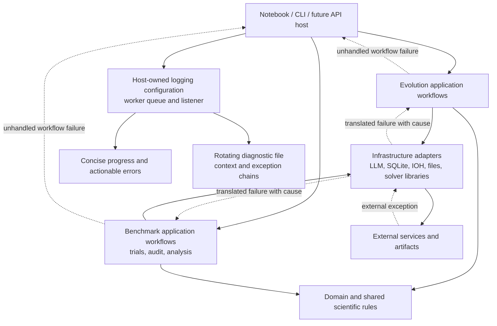

# System-wide error handling and logging

**Status: Proposed — not implemented.**

This plan covers synthesis, native and optional benchmark workflows, audit,
analysis, statistics storage, figure export, maintenance and command-line tools.
It replaces scattered error reporting with a common operational policy while
preserving the evolution and benchmark context boundaries.

The gateway retry warning added during diagnosis remains a local visibility fix.
It is not an implementation of this plan.

## 1. Scope and safeguards

- Preserve optimization mathematics, candidate scoring, budgets, instance/seed
  schedules, timeouts, champion selection, trace eligibility and statistical
  settings. Do not change candidate execution isolation or timeout mechanisms.
- Preserve database schema, stored scientific results, checkpoint formats,
  provenance schema and existing figure filenames/styles.
- Distinguish experimental failure from infrastructure failure for future
  execution. Do not reinterpret or rewrite historical failed observations.
- No campaign launches, database migrations, automatic reruns, results cleanup,
  figure regeneration or changes to private credentials during this migration.
- Keep required dependencies explicit. Avoid generic Result wrappers, an error
  class per service, automatic exception decorators, event buses, logging
  frameworks, remote logging services or a new bounded context.
- Coordinate deployment with running jobs. Existing workers retain imported
  code; changing files does not update an active worker or notebook kernel.

## 2. What the repository currently does

The inspection found 39 exception handlers in `src/`, including 26 handlers for
`Exception` or `BaseException`, and five direct `print()` calls. Counts describe
the inspected revision; they are an inventory, not targets to minimize blindly.

| Area | Observed behavior | Required correction |
| --- | --- | --- |
| Synthesis and benchmark logging adapters | Constructors configure shared named loggers, clear handlers and disable propagation | Configure destinations once at the host; adapters emit progress records |
| Gateway | Bounded paced retries; recent warnings show cooldowns; HTTP read timeout is separate from candidate timeout | Keep transport recovery local; route retry diagnostics centrally and expose waiting state |
| LLaMEA integration | Third-party initialization/evolution catches generation exceptions and prints diagnostics | Ensure terminal provider failures leave the synthesis workflow without becoming candidate fitness failures |
| Process dispatcher | Collects task errors and raises an aggregate after batch processing | Surface failures promptly; distinguish independent task failure from shared dependency outage |
| Candidate and benchmark evaluation | Broad catches classify execution/scoring failures | Retain arbitrary generated-code failure handling, but narrow the protected operation so backend failures propagate |
| Synthesis repository | Missing summary row prints and returns; WAL checkpoint catches every exception and prints | Failed required writes must propagate; deliberate best-effort maintenance gets explicit diagnostics |
| IOH readers/state store | Some parsing errors are ignored; unreadable provenance can become `None`; run counts fall back | Distinguish absent, invalid and unreadable artifacts; expose exclusions without changing valid-data eligibility |
| IOH log merging | JSON merge exceptions can be swallowed after trace files are appended | Report partial persistence failures; do not acknowledge a complete condition after failed artifact updates |
| Model registry | Broad catch returns an empty registry | Keep intentional absent-registry fallback; report invalid or inaccessible configured input |
| Statistical engine | Broad catches produce unavailable test values | Handle only characterized numerical limitations; unexpected faults propagate |
| Analysis result store | Atomic per-file writes and checksum validation already exist | Preserve cleanup and validation; attach useful operation/artifact context to failures |
| Figure exporter | Some unavailable outputs print, others silently return; write failures propagate | Return an explicit export summary and route diagnostic errors through the presentation boundary |
| Maintenance and lifecycle | Several broad catches clean up and rethrow | Preserve these useful handlers; protect the original failure if cleanup also fails |
| Shell/Python tools | Interactive messages, machine-readable stdout and exit statuses coexist | Preserve CLI contracts; send operational failures to stderr/logs without contaminating stdout data |

The domain packages do not need logging configuration. Existing condition-status
results, analysis diagnostics and recorded candidate/trial diagnostics remain
valuable; they should not be replaced with exceptions indiscriminately.

## 3. Ownership and propagation



Exceptions follow the call stack, not an event bus. Logging records follow the
configured logger hierarchy/worker queue. Dishka constructs collaborators and
owns resources; it does not automatically catch workflow failures or establish
an operation scope for every service method.

| Layer | Error responsibility | Logging responsibility |
| --- | --- | --- |
| Domain/shared science | Enforce invariants; return existing explicit unavailable/status results where absence is normal | No IO, handler setup, colored output or operational logging |
| Infrastructure | Recover locally when safe, translate external failures at useful boundaries, retain causes, release resources | Emit contextual operational events through standard named loggers; never choose notebook/file destinations |
| Application | Decide whether to continue, stop scheduling, persist a candidate failure or reject an operation | Emit workflow progress; attach scientific identity; do not log-and-rethrow the same terminal failure repeatedly |
| Host/presentation | Own invocation lifecycle and final user-facing error mapping | Configure destinations and levels; record terminal workflow exceptions once |

An exception should be caught only to recover, translate meaning, record a
deliberate outcome, aggregate independent work or clean up. Cleanup-only catches
must rethrow. Use bare `raise` to propagate and `raise ... from error` to translate.
Do not use `from None` simply to hide diagnostic causes.

## 4. Small exception vocabulary

Define errors by decisions callers must make, not by folder names.

- Keep existing `SynthesisResumeError` and the useful structured task information
  in `OrchestrationError`.
- Add an evolution application `ProviderError` with a small typed reason set
  for authentication, exhausted quota, unavailable service, request timeout and
  invalid response. Preserve safe status/retry metadata and the original cause.
  Do not expose SDK exceptions or HTTP status mapping as domain concepts.
- Add shared application storage/artifact errors only where multiple adapters
  need the same contract: required persistence failed versus an existing artifact
  that cannot be read or validated. One cohesive errors module is sufficient;
  do not wrap every individual file operation in another exception layer.
- Keep ordinary `ValueError`, `TypeError` and existing validation errors when
  callers do not need a different recovery policy. Domain invariant exceptions
  belong in the owning domain only when they carry distinct domain meaning.
- Keep candidate execution errors separate from provider/storage errors. If a
  shared execution-boundary error is needed to distinguish generated-code faults,
  place it with the existing execution contract rather than in either context's
  domain. Preserve existing scientific failure category names in stored outcomes.
- Custom exceptions crossing process boundaries must be picklable and tested.
  Preserve remote traceback information; a concise message is not its replacement.

No context imports another context's internal exceptions. Shared errors contain
only genuinely shared runtime/IO semantics. Future HTTP mapping belongs to the
API host, not these exceptions or application use cases.

## 5. Workflow-specific policies

| Situation | Policy |
| --- | --- |
| Generated optimizer runtime error, invalid returned point or timeout | Record the existing experimental failure and diagnostics; continue as before |
| Expected empty analysis, missing optional trace or incomplete condition | Return existing unavailable/coverage diagnostics; never manufacture zero curves or failed trials |
| Stale hash/schema/budget or excluded instance schedule | Use existing condition-status/eligibility rules; display the exclusion reason |
| Existing artifact is corrupt or access is denied | Identify the artifact and reason; do not treat it as absent or trigger destructive replacement |
| Temporary external transport/rate-limit failure | One bounded retry owner in the adapter; shared pacing remains in place |
| Authentication failure, exhausted quota or terminal provider failure | Surface a workflow error; stop admitting further affected synthesis work; preserve completed results |
| Database/code/provenance persistence fails | Stop the affected workflow; do not report successful completion or convert the error into optimizer failure |
| Known undefined statistical comparison | Return unavailable values and a typed/structured diagnostic using unchanged numerical rules |
| Unexpected statistical/backend bug | Propagate to the operation boundary with the original cause |
| Figure export dependency/browser/permission failure | Report export failure with target context; leave calculated results usable |
| User cancellation | Stop pending work and clean up; do not score it as candidate failure or claim already-running native work was terminated |

### Synthesis and worker dispatch

Characterize LLaMEA's internal catches before modifying integration. Use a narrow,
documented adapter hook to preserve terminal provider failures through the library
boundary and re-raise them at the application boundary. Do not edit installed
packages, raise `BaseException` as an escape mechanism or assign fitness penalties
to API outages. If the supported library hooks cannot provide this guarantee,
resolve the adapter/library integration explicitly before proceeding.

The dispatcher owns futures and their diagnostic transport. Application policy
decides whether a failure affects just one task or the shared provider/storage.
Stop further submissions for a systemic failure; avoid eagerly queuing the entire
matrix if cancellation would be ineffective. Preserve worker count, task payload,
ordering requirements and module-level worker picklability.

Do not promise immediate cancellation of already-running futures. Finish or
interrupt them only using supported current mechanisms; report their state
accurately. API waiting/failure must not increment completed optimizer generations.
An interrupted invocation leaves completed records intact and unfinished work
eligible for the existing recovery rules.

### Benchmarking, audits and trace loading

Keep workload/status inspection read-only. Add structured read diagnostics to
reader results where needed; update all callers together rather than logging
once per file or relying on mutable `last_errors` state.

An absent optional file can remain absent. Corrupt provenance must be distinguishable
from no provenance in both audit and execution: execution must not delete or replace
the directory merely because parsing failed. Read-only audit may continue with an
explicit invalid-artifact row. Analysis may exclude that condition with a visible
diagnostic; it must not describe the reduced dataset as complete.

Keep the distinction between terminal outcomes and available trajectories. Do not
change historical fallback interpretation or mathematical denominators in this
refactor. Any newly surfaced ambiguity that would change eligibility needs its
own reviewed decision and characterization fixture.

For IOH merging, identify partial writes and fail the operation rather than
silently committing a successful terminal record. Preserve existing traces and
atomic provenance replacement. Do not introduce a trace-schema migration or
silently repair existing malformed artifacts.

### Analysis, statistical calculations and export

Application analysis use cases keep returning calculated results and diagnostics.
Expected numerical limitations remain data, not log messages in domain engines.
Narrow numerical catches to verified library cases; unexpected exceptions must
not become a fabricated p-value, tie or zero curve.

Keep figure creation/export in notebook-owned code. Replace inconsistent printing
and silent skips with one small export summary containing produced paths, skipped
outputs and reasons. Export write failures raise with target context. Do not add
a generic Result class to all APIs or mix Plotly into the backend.

Statistical snapshot writing remains an explicit IO operation. Retain checksums,
per-file atomic replacement and cleanup; diagnostic logging does not make a
multi-file export transactional. Do not claim all artifacts were saved until the
existing completion/manifest conditions are met.

### Maintenance and command-line tools

Database maintenance retains backups, transactions and read-only archive guards.
Report failed required writes; document which optional housekeeping can safely
fail without invalidating the operation. A passive WAL checkpoint failure is not
automatically equivalent to a failed committed experiment write.

Keep CLI stdout reserved for documented data or intentional interactive output.
Send diagnostic failures to stderr and preserve nonzero exit codes and existing
signal handling. Shell scripts do not need a Python DI container. Do not replace
all `echo`/`print` calls blindly; script outputs may be machine-readable contracts.

## 6. Host-owned logging

Use Python's standard `logging`; no new logging dependency is required.

Create a small shared infrastructure logging package, initially only configuration/
lifecycle and formatting/context responsibilities. Avoid a registry, generic
logging service or separate factory per component.

- Configure application logger roots (`evolution`, `benchmark`, `shared`) once
  per host. Child loggers propagate to those roots. Avoid changing unrelated
  Jupyter/server root handlers, clearing another component's handlers or using
  `basicConfig(force=True)` globally.
- Keep existing progress adapters as focused scientific progress presenters.
  Remove their handler ownership and duplicated generic error-printing behavior;
  use ordinary standard loggers for operational diagnostics.
- Carry structured fields with logging records: invocation ID, workflow,
  experiment ID where applicable, model, condition, generation/trial, instance,
  process, operation and attempt. Only provide fields that actually exist.
- An invocation ID identifies a notebook/CLI run; it is not a new experiment ID,
  campaign data model, database column or cache key.
- Establish context once around an application operation. Propagate it explicitly
  to spawned workers; thread/context-local state does not cross processes by magic.
- Avoid global mutable verbosity changes on a shared named logger. Quiet/verbose
  presentation filtering is scoped to the host or invocation and must not disable
  diagnostic capture for other simultaneous workflows.

### Destinations and severity

Default local destinations:

```text
logs/<workflow>/<invocation-id>/diagnostics.log
```

Use size-limited rotation with finite backup counts. Keep logs outside research
results and archives. Record the log location at workflow start and with actionable
errors. Files use UTC timestamps, plain structured text and full exception chains;
console output retains existing scientific colors and numeric formatting.

| Record | Notebook/console | Diagnostic file |
| --- | --- | --- |
| Condition/generation/trial progress | Existing readable rows | Contextual INFO |
| Individual API attempt or routine pacing | Normally hidden | DEBUG |
| Prolonged external wait/repeated transient issue | One concise state change or bounded reminder | WARNING with attempts/status/delay |
| Expected candidate failure | Existing failure row | Diagnostic details, not a second terminal workflow error |
| Terminal workflow failure | One concise actionable error | ERROR with traceback once |
| Unexpected backend defect | Concise failure with log reference | ERROR with full exception chain |

Recovered retries are operational events, not repeated terminal failures. Coalesce
repeated console warnings while retaining useful counts/details in the file.
Show waiting state based on actual operations; never manufacture progress while
blocked on IO. Retain the separate meaning of API timeout and optimizer timeout.

Redact credentials, authorization headers and known secret values at diagnostic
boundaries. Do not serialize entire SDK requests, private environment variables,
exception argument dictionaries or full prompt histories into normal logs.
Keep scientific candidate feedback and existing provenance diagnostics in their
current stores; logs supplement them rather than replace them.

### Multiprocessing and lifecycle

Use `QueueHandler` in workers and a parent `QueueListener` owning file/console
handlers. Configure the worker once using the process initializer, not once per
log call or by passing live handlers in task payloads. Preserve traceback text
when preparing records for the queue; standard queue preparation needs deliberate
formatting so exception details are not lost.

Choose and test a queue/shutdown policy that does not silently discard failures.
Do not route the multiprocessing queue's own debug logger through itself. Flush
records before closing handlers; stop/drain the listener after workers finish.
Never let a worker inherit and use a parent file handler under fork.

Use explicit `start()`/`stop()` support compatible with Python 3.11; do not depend
on QueueListener context-manager features introduced in newer Python versions.

Host startup owns logging independently of Dishka request scopes. Integrate
cleanup with the existing workflow lifecycle rather than requiring users to wire
queues, handlers and listeners in notebook cells. Startup failure must still be
reportable; logging cannot require a healthy database or LLM connection.

For multiple notebook workflows in one kernel, do not stack handlers or close
another live invocation's output. Test concurrent scopes and repeated setup.
Future FastAPI startup/request/shutdown hooks can use the same configuration and
operation-context policy. No API server is implemented by this plan.

Cloud deployment can send the same structured records to stdout for a platform
collector instead of local files. A VPS does not automatically provide useful
application logs: the host/collector must be configured. Do not add cloud agents
or infrastructure now.

### Third-party and generated-code output

Prefer library logging hooks and supported verbosity controls for LLaMEA, IOH,
solver libraries and HTTP clients. Do not suppress scientific warnings globally.
Capture unavoidable third-party output only at a boundary where output ownership
is safe, such as an exclusive worker process, and restore streams afterward.

Do not redirect the notebook parent's global stdout/stderr around concurrent
threads or monkey-patch `print`. Existing generated optimizer source remains fixed.
If safe capture would require new execution isolation, document that limitation
and defer it rather than changing execution behavior as a logging cleanup.

## 7. Terminal reporting: one owner

The outer application operation classifies recoverable workflow conditions and
preserves failure context, without repeatedly logging and rethrowing at every
layer. The notebook/CLI host boundary owns the final diagnostic log and concise
presentation. Provide one small reusable boundary helper only if necessary;
do not put repetitive try/except blocks around every notebook cell or service.

Direct service calls must still raise useful typed failures without the host
helper. Do not turn failures into successful empty returns merely to avoid a
notebook traceback. Developer traceback mode remains available.

Worker diagnostic detail and the parent aggregate must be correlated: print one
batch summary, retain per-task causes, and avoid writing the same full stack again
for every wrapper. Do not lose the successful results of independent completed
tasks when reporting the aggregate.

Cleanup errors must not replace the primary failure. Report both with primary
failure priority. `KeyboardInterrupt`, `SystemExit` and future async cancellation
must propagate appropriately; broad `BaseException` is limited to cleanup-and-
rethrow or an explicitly documented host shutdown boundary.

## 8. Migration order and affected files

1. **Characterization and error inventory.** Classify every catch as retry,
   translation, outcome conversion, cleanup or accidental suppression. Record
   current scoring/eligibility/serialization and CLI stdout contracts.
2. **Central logging foundation.** Add shared infrastructure configuration,
   formatting/context and managed worker routing. Migrate both logging adapters,
   `shared/infra/lifecycle.py`, module DI composition and process initialization.
   Keep scientific progress APIs/styles while removing constructor handler setup.
3. **Execution and persistence contracts.** Update the shared execution boundary,
   synthesis repository, checkpoint/code adapters, IOH read/write/merge adapters
   and analysis result storage. Preserve causes and distinguish corrupt from absent.
4. **Synthesis policy.** Update LLM client/gateway, LLaMEA integration, dispatcher
   and campaign/single-session workflows. Remove duplicate retry reporting and
   prevent terminal provider failures from entering scientific candidate results.
5. **Benchmark, audit and analysis policy.** Narrow trial/scoring catches; migrate
   structured read diagnostics through workload, audit, data loader and analysis
   outputs. Narrow statistical catches without changing valid calculations.
6. **Presentation and tooling.** Update all repository notebooks, PNG exporter,
   snapshot export calls and relevant CLI tools. Standardize export summaries,
   log references, cancellation and script exit/reporting behavior.
7. **Remove obsolete reporting.** Delete replaced generic logger methods,
   redundant print/exception wrappers and blanket suppression only after all
   callers migrate. No compatibility-only shims or parallel logging systems.
8. **Documentation and verification.** Update architecture, execution/recovery,
   model configuration and notebook workflow guides to describe the implementation.

Each step remains reviewable. If a change would alter successful scientific
results, timeout behavior, trace eligibility or historical serialization, stop
that part of the migration and resolve the discrepancy before continuing.

## 9. Acceptance checks

- Identical candidate gaps, penalties, evaluation counts, seeds, statistical
  values, ECDF/convergence curves and success rates for characterized valid inputs.
- Candidate runtime failures still count as existing scientific failures;
  provider, persistence and unexpected backend errors do not become observations.
- Missing, corrupt, stale, incomplete and unreadable artifacts are distinguishable
  in audit/analysis diagnostics without fabricated failures or automatic deletion.
- Finite retries remain paced across spawned workers; waits and terminal errors
  are visible with no duplicate full terminal traceback.
- Authentication, quota, connection, read-timeout, invalid-response, disk-full,
  permission, locked database, corrupt JSON and failed checkpoint cases tested
  with substitutes/fault injection, not live production campaigns.
- Original exception causes and useful remote stacks survive translation and
  multiprocessing; custom exceptions remain picklable.
- Logging startup works before DB/LLM construction. Repeated and concurrent
  notebook setup neither duplicates records nor steals/closes other handlers.
- Rotation, ANSI-free files, contextual records, credential redaction, worker
  queue delivery and clean cancellation/shutdown verified.
- Failed writes preserve previous artifacts and are never reported as complete.
  Cleanup failures do not mask the primary error.
- CLI machine-readable stdout, exit statuses, backup guards and shell syntax
  remain compatible. Notebook cells compile and existing imports work.
- Architecture checks reject domain presentation/IO dependencies and cross-context
  core imports. New logging code stays in infrastructure; error contracts remain
  inward of the adapters that implement them.
- Run relevant failure, scientific characterization, process/pickling, resumption,
  analysis, export and notebook suites, then full tests and lint/import checks.

## 10. Guidance used

These sources inform the policy; this plan adapts their principles rather than
copying a Java/.NET framework or claiming a single universal industry design.

- [.NET exception best practices](https://learn.microsoft.com/en-us/dotnet/standard/exceptions/best-practices-for-exceptions):
  catch where recovery/cleanup is possible and preserve exception information.
- [.NET logging](https://learn.microsoft.com/en-us/aspnet/core/fundamentals/logging/):
  host-configured providers, named categories, levels and contextual scopes.
- [ASP.NET Core error handling](https://learn.microsoft.com/en-us/aspnet/core/fundamentals/error-handling):
  final request-boundary error handling and safe user-facing presentation.
- [Spring Boot logging](https://docs.spring.io/spring-boot/reference/features/logging.html):
  centralized logging configuration, console/file destinations and rotation.
- [Spring DAO support](https://docs.spring.io/spring-framework/reference/data-access/dao.html):
  translate technology-specific persistence exceptions while preserving causes.
- [Spring error responses](https://docs.spring.io/spring-framework/reference/web/webmvc/mvc-ann-rest-exceptions.html):
  HTTP error mapping at the web boundary; keep this a future API concern here.
- [Python logging cookbook](https://docs.python.org/3.13/howto/logging-cookbook.html):
  logger hierarchy, multiple destinations, contextual records and queue-based
  multiprocess logging. Retain the repository's Python 3.11 compatibility.
