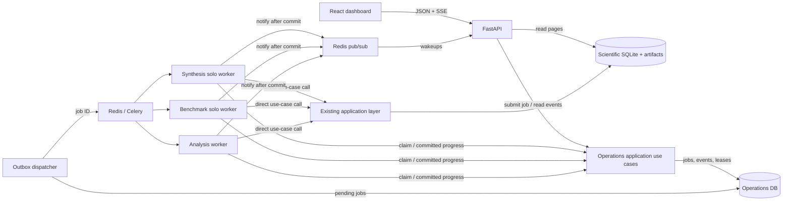
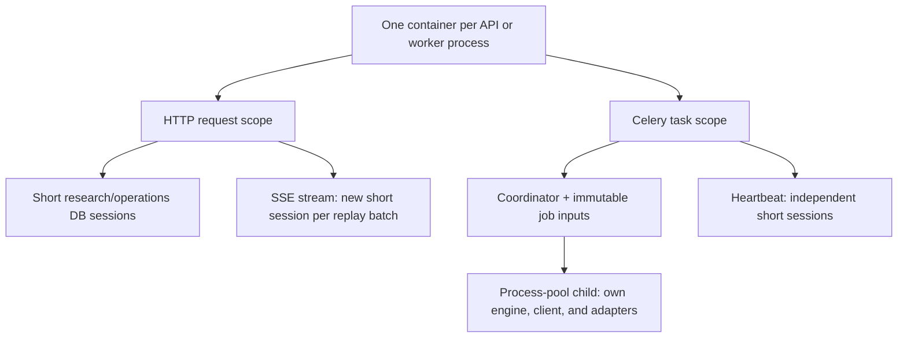
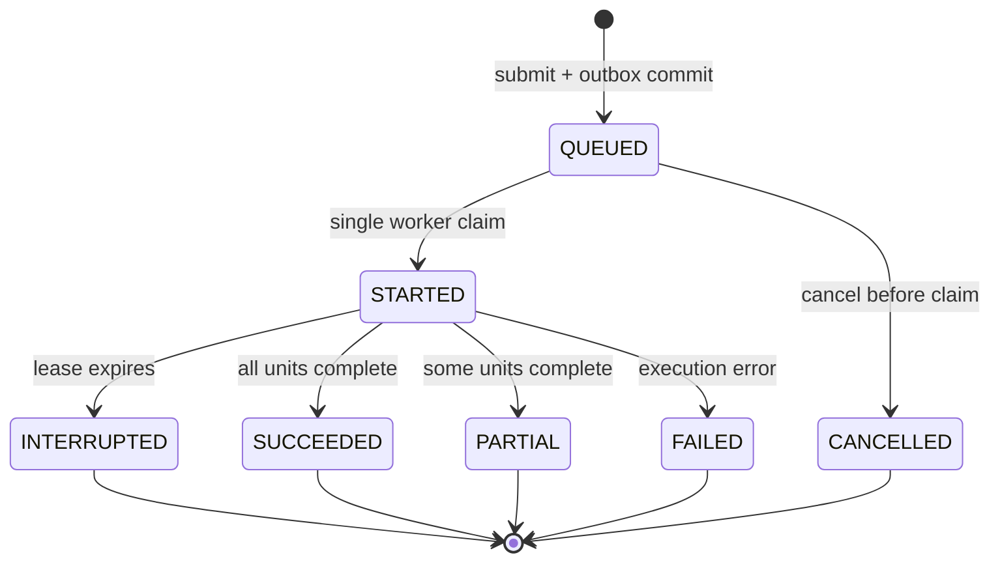
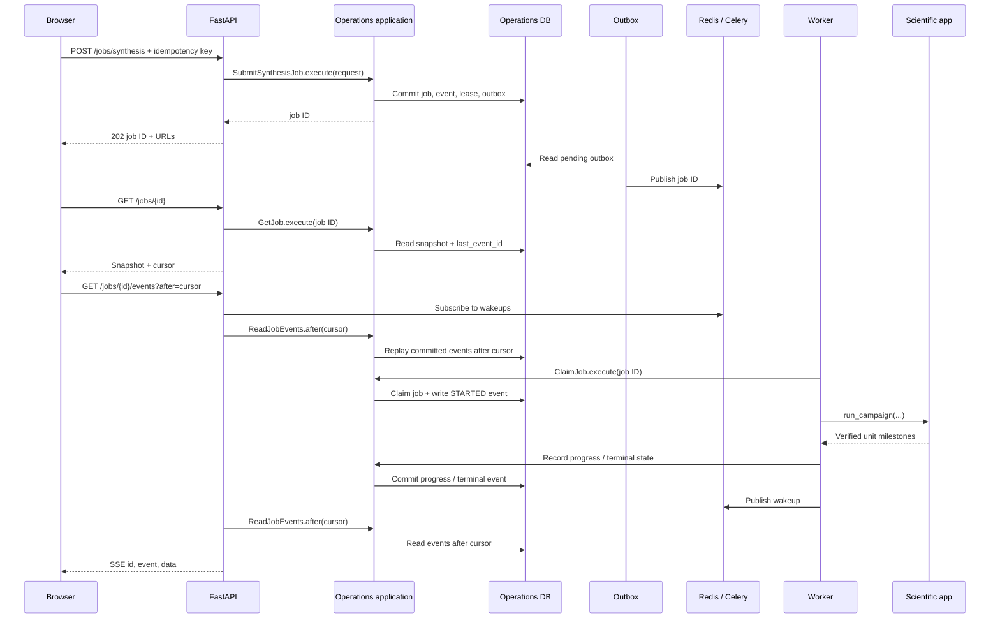

# Research dashboard and job system: implementation plan

Status: **design only**. No API, frontend, broker, or worker has been added. Updated 22 October 2026.

## 1. Decisions

| Concern | Choice | Implementation rule |
| --- | --- | --- |
| Repository | Keep `web/` in this repo | Separate `package.json` and lockfile; Python remains in `pyproject.toml`. |
| Frontend | React + TypeScript + Vite | Vite serves development assets; a reverse proxy or FastAPI serves the static production build. FastAPI remains the data server. |
| UI data | React Router, TanStack Query/Table, Plotly | URL-addressable records; server-side pages and filters; charts from typed API series. Use Tailwind + shadcn/ui for controls. |
| API | FastAPI + Pydantic | Thin HTTP adapters over existing application use cases and new read projections. Generate the TypeScript client from OpenAPI. |
| Dependencies | Scoped DI container; trial Dishka first | Provider modules construct use cases and own resource cleanup. Routes/tasks invoke concrete use cases directly; no `Module.execute(command)` or command bus. |
| Jobs | Celery + Redis, separate operations DB | Celery executes; the operations DB stores authoritative state, attempts, events, leases, and dispatch outbox. |
| Live updates | Server-sent events (SSE) | Browser fetches a job snapshot, then streams replayable committed events. Redis notification is only a wakeup. |
| First deployment | One local writable study | Keep existing synthesis process-pool parallelism; serialize writes until every study resource is isolated. |

Next.js would add a Node server without a current server-rendering need. FastAPI already owns authentication, records, and job commands. Revisit Next.js if server-rendered pages or a JavaScript backend-for-frontend becomes a requirement. Vite still needs an HTTP server: its development server during development, and a static-file server in production.

## 2. Architecture



The scientific contexts remain `src/evolution`, `src/benchmark`, and `src/shared`. Add `src/operations` as a supporting job context, `src/api` for HTTP adapters and read projections, `src/worker` for Celery adapters, and `src/di` for composition. Keep the suggested top-level layout: this repository already tests that the `evolution` and `benchmark` cores are independent. Group routes and tasks **by feature inside their adapter packages**; do not place one FastAPI app or Celery worker inside each scientific domain. None of the scientific application/domain modules should import FastAPI, Celery, Redis, or the DI container.

### Two distinct application calls

| When | Adapter calls | Responsibility | Duration |
| --- | --- | --- | --- |
| `POST /jobs/synthesis` | `SubmitSynthesisJob` in `src/operations/application` | Validate the request, reserve the study, save a `QUEUED` job and outbox row, return its ID. It **does not** call `run_campaign()`. | Short HTTP request. |
| Celery receives the job ID | Task wrapper calls `ClaimJob`, then `SynthesisCampaignCoordinator.run_campaign()` | Load frozen inputs, acquire task-scoped resources, run the existing scientific workflow, record progress and terminal state. | Long worker task. |
| `GET /jobs/{id}` or `/events` | `GetJob` / `ReadJobEvents` in `src/operations/application` | Read persisted status/events; SSE streams them to the browser. | Short snapshot request or long read-only stream. |

The API talks to the **operations application layer first**, because submitting a job is its own use case. The operations use case writes an outbox record; an infrastructure dispatcher later publishes the job ID to Celery. Celery is only the transport and execution host. Its task adapter calls the **scientific application layer** directly. A progress-observer port lets synthesis report milestones without importing Celery or the operations database. Operations use cases depend on repository ports; the dispatcher uses a queue-publisher port. DI supplies their adapters.

Suggested layout:

```text
web/src/features/{overview,experiments,benchmark,analysis,jobs}/
web/src/api/                 generated client and query hooks
src/evolution/               existing synthesis domain/application/infra
src/benchmark/            existing benchmark + analysis domain/application/infra
src/operations/application/  submit, claim, progress, read, reconcile use cases
src/operations/infra/        job/event/lease/outbox persistence adapters
src/api/routes/              synthesis, benchmark, analysis, jobs HTTP routes
src/api/reads/               paginated and bounded query adapters
src/worker/tasks/            synthesis, benchmark, analysis Celery task adapters
src/worker/                  outbox dispatcher and reconciler processes
src/di/                      provider modules and process-local containers
src/*/infra/di.py             reusable context-owned Dishka registrations
src/*/infra/module.py         public module façades with internal operation scopes
notebooks/*.ipynb             notebook-owned initialization; not used by the HTTP server
```

Dependency rule: `api` and `worker` may call `operations`, `evolution`, and `benchmark` application use cases; `operations/application` owns generic job policy and its ports, without importing the scientific contexts; scientific application/domain code stays unaware of all delivery adapters. `di` is the only place that wires implementations across these boundaries. This keeps feature ownership clear without creating a separate deployable API/worker per domain.

### Dependency and resource lifetimes



Create `SharedProvider`, `EvolutionProvider`, `BenchmarkProvider`, `AnalysisProvider`, and `OperationsProvider`. The API and Celery worker each build a process-local root from these definitions. Request/task scopes resolve a **concrete use case** and close owned resources. The route or task calls its method directly. A provider is dependency registration, not a runtime domain facade. The notebook entry points already resolve workflows through context-owned Dishka providers; extend these registrations for the server.

Never share a SQLAlchemy `Session`, engine, Redis connection, LLM client, or DI container across a process-pool boundary. `run_synthesis_worker()` already creates and disposes a child-local `Database`; extend its child-local context for progress and, later, study-specific paths. Use short transactions even inside an hours-long task or SSE stream. Verify Celery `solo` + the inner process pool on the deployment OS before turning on job submission.

## 3. What the current backend can supply

| Screen/action | Existing entry point | Work needed at the boundary |
| --- | --- | --- |
| Experiment list/detail/iterations | `SQLiteSynthesisRepository`; `experiments`, `iterations`, `error_logs` | New indexed, paginated read queries. Existing `load()` and DataFrame helpers load too much for a table. |
| Synthesis coverage | `CampaignAuditor.audit_matrix()` | Read-only composition and bounded response; distinguish historical `running` rows from an active job. |
| Synthesis run/recover/replace/resume | `SynthesisCampaignCoordinator.run_campaign()` | Worker wrapper, strict ID validation, immutable inputs, progress hooks, and checkpoint validation. |
| Synthesis preview | `CampaignPlanner.build_tasks()` is mutating | New non-mutating preview use case; never call `build_tasks()` from preview. |
| Champion catalog | `ChampionSelectionService` | Typed filtered projection; no export on GET. |
| Benchmark coverage/comparisons | `BenchmarkAuditService.get_audit_data()`, `BenchmarkCoordinator.summarize_results()`, condition-status policy | Reuse scientific validity rules; cache or materialize bounded responses. Existing methods return broad DataFrames. |
| Benchmark run | `BenchmarkCoordinator.run_benchmarks(solver_type=...)` | Worker wrapper; validate `all`, `champions`, `noise_robustness`, `cross_function`, `baselines`. Current use case cannot launch one arbitrary table row. |
| Analysis calculations | Four `BenchmarkModule.analyze_*` methods | Worker wrapper; initialize/close modules through server/job lifecycle and keep numerical persistence separate. |
| Saved analysis views | `AnalysisResultsStore.load()` | New manifest catalog and bounded series/table queries keyed by validated snapshot ID. |
| Jobs/events/SSE | No current use case | New `operations` application layer and adapters. |

Notebook 02 and 03 currently write directly. Their writes must join the same study lease before browser write actions are enabled. Current configs and storage paths are global; changing only `DATABASE_URL` does not make concurrent studies safe. Existing Dishka providers own engine finalization; API and worker scopes must preserve this lifecycle.

## 4. First user experience and API

| View | Minimum useful content |
| --- | --- |
| Overview | Current protocol, synthesis coverage, benchmark readiness, recent jobs, clear stale/missing counts. |
| Experiments | Server-paged filterable table; experiment detail with iterations, errors, candidate metadata. |
| Benchmark | Coverage matrix and comparisons; valid-trial denominator, budget, solver/mode, provenance, rerun reason. |
| Analysis | Saved snapshot catalog and selected ECDF, reliability, robustness, performance charts. |
| Jobs | Submission/preview, status, per-session progress, event history, resume eligibility, artifact links. |

Every scientific table/chart identifies the study, protocol, metric, filters, and valid sample count. Missing and stale results are states, never numeric zero. Native, noise-robustness, and cross-function evaluations remain distinct.

Version all routes under `/api/v1`:

```text
GET  /overview
GET  /experiments?model=&problem_id=&status=&limit=&cursor=&sort=
GET  /experiments/{id}
GET  /experiments/{id}/iterations?limit=&cursor=
GET  /synthesis/overview
POST /synthesis/preview                    read-only
GET  /benchmark/coverage?study=&model=&status=
GET  /benchmark/comparisons?problem_id=&dim=&noise_std=
GET  /analysis/snapshots
GET  /analysis/snapshots/{id}/series?condition=&metric=&max_points=
POST /jobs/synthesis
POST /jobs/benchmark
POST /jobs/analysis
GET  /jobs?status=&kind=
GET  /jobs/{id}
GET  /jobs/{id}/events?after=<sequence>   SSE
```

Use Pydantic schemas at the HTTP edge, explicit application arguments/request models, allowlisted filters/sorts, bounded page sizes, and artifact IDs instead of filesystem paths. Reads must not start scientific work. Submission accepts a server-registered model key or supported enum, never credentials, arbitrary code, shell commands, or filesystem paths. Return `202` with `{job_id,status_url,events_url}`; a conflicting writer returns `409` with its active job reference.

### Synthesis submission contract

The UI offers four modes: `full_matrix`, `recover`, `resume_ids`, `replace_ids`. Map them to the existing `run_campaign(recover=..., resume_experiment_ids=..., rerun_experiment_ids=...)`. Validate that selected IDs belong to the chosen model/study and that mode/ID combinations are legal. Preview must show affected IDs, estimated task count, and checkpoint readiness without creating rows. `replace_ids` clearly states that it replaces iterations, champion/code, and checkpoint. An invalid or missing checkpoint blocks **resume**; starting fresh must be an explicit different choice.

## 5. Durable job lifecycle



Resume creates a **new linked job**, preserving the old attempt and experiment IDs. Add `CANCEL_REQUESTED` and running cancellation only after a cooperative signal reaches synthesis sessions/benchmark trials. Do not equate Celery revoke with safe cancellation. Store per-session outcomes so an aggregate process-pool error does not hide completed experiments.

Operations DB minimum schema:

| Table | Key fields / constraint |
| --- | --- |
| `jobs` | ID, kind, study, requester, idempotency key/request hash, immutable protocol/model inputs, status, timestamps, counters, prior-job ID, artifact references. Unique `(requester, idempotency_key)`. |
| `job_attempts` | Job, attempt, worker, started/heartbeat/finished times, outcome. |
| `job_events` | Job, monotonic sequence, event type, time, bounded JSON. Unique `(job_id, sequence)`. |
| `job_outbox` | Job, dispatch state, attempts, next retry time. Written in the same transaction as `QUEUED`. |
| `study_leases` | One active writer reservation per study, owner job, expiry/renewal. Notebook writers use the same lease. |
| `job_units` | Experiment/condition key, state, completed/total iterations or trials, last verified scientific commit. |

Submission commits the queued job, initial event, lease reservation, and outbox row atomically. An outbox dispatcher sends **only the job ID** to Celery. A worker makes one conditional claim in the operations DB, reloads the immutable inputs, enters its DI task scope, and calls the scientific use case. Duplicate queue delivery cannot start a second writer. The worker commits each state/event before publishing a Redis wakeup. A separate reconciler detects expired heartbeats and marks the attempt `INTERRUPTED`.

The scientific DB, filesystem, and operations DB cannot share one transaction. Emit progress after the scientific commit, record experiment/iteration or trace identity, and reconcile missing events from saved science state after a crash. A Redis notification or Celery result is never proof that scientific data was committed.

### Request path and SSE replay



The job snapshot is authoritative and includes `last_event_id`. The browser connects from that cursor; on automatic reconnect, `Last-Event-ID` takes precedence. The stream authorizes the job, subscribes to wakeups **before** replay, reads ordered committed events, and periodically rechecks the DB in case a wakeup is lost. Keepalive comments prevent idle disconnection. Close the stream at a terminal event or browser disconnect; the worker continues if the browser leaves. If history was pruned, send an explicit resync event and fetch a fresh snapshot. SSE is one-way; start/resume use normal POST requests.

Event payloads contain job ID, sequence, timestamp, unit ID, and bounded progress/error summary. They exclude generated code, secrets, raw traces, and full tracebacks. Persist heartbeat independently of the blocking campaign call. The UI shows a percentage only when the denominator is known and refreshes affected science queries after a terminal event.

For remote access, authenticate SSE and every job command against the study. Use same-origin cookies or a designed stream token because browser `EventSource` cannot add arbitrary request headers. Disable proxy buffering on SSE, set keepalive/idle limits, and cap streams per user. The local pilot can defer remote authentication, but keep submission bound to a trusted local interface.

## 6. Worker and storage policy

| Queue | Initial execution | Constraint |
| --- | --- | --- |
| `synthesis` | Dedicated Celery `solo` worker, one campaign for the active study | Existing `ProcessPoolRunner` owns session parallelism. Each child owns its DB engine and reconstructed LLM client. Cap total CPU/processes. |
| `benchmark` | Dedicated single-writer `solo` worker | Serialize overlapping trace/code targets; freeze champion/code identity and trial protocol before executing. |
| `analysis` | Separate worker over a stable snapshot | Prefork is optional only after verifying no nested child processes. Large reads stay off the API process. |

Start with early task acknowledgment and no automatic retry of non-idempotent scientific writes. On worker death, the reconciler reports interruption; a deliberate new job recovers or resumes. Avoid prefetching several long tasks into one busy worker. Redis is the broker; its task result backend and pub/sub are not job history. SQLite WAL allows readers alongside a writer but still has one writer at a time. If multiple hosts/users are required, use PostgreSQL for the operations DB and explicit shared artifact storage; do not infer multi-study isolation from extra Celery workers.

Freeze at submission: validated parameters/protocol hash, source revision, model identity, requested mode/IDs, and benchmark champion/code manifest with experiment/iteration IDs, hashes, copied code, trial schedule, and budget. The worker uses this snapshot, not whichever notebook parameters or champion are current when the queued task starts. Implement the separate [campaign isolation design](campaign_isolation.md) before enabling concurrent writable studies.

## 7. Delivery plan and acceptance gates

| Phase | Implement | Done when |
| --- | --- | --- |
| 0. Contracts and spike | Decide local study identity; define job schemas/state, immutable inputs, writer lease, API examples; verify Dishka scopes and Celery `solo` + inner process pool. | Child processes have distinct DB resources; all are disposed; a worker can run without inheriting parent connections. |
| 1. Read API | Paginated experiments/iterations, synthesis and benchmark audit projections, comparisons, snapshot catalog/series, OpenAPI models. | Read results match notebook audit; GETs do not mutate rows/files; pages and chart series are bounded; historical protocols are labeled. |
| 2. Explorer UI | `web/` app, navigation, filters, linked record views, coverage and analysis charts, loading/empty/error states. | A user can trace a benchmark cell to an experiment and see why it is valid, stale, partial, or missing. |
| 3. Job control plane | Operations DB migrations, lease, outbox, single claim, events, SSE replay, heartbeat, reconciler, job page. | Duplicate submission/dispatch starts one job; reconnect replays events; a killed worker becomes `INTERRUPTED`; API stays responsive. |
| 4. Scientific jobs | Non-mutating preview, strict resume checks, immutable job inputs, notebook lease integration, progress hooks, worker wrappers for synthesis/benchmark/analysis. | Notebook/API writes cannot overlap; benchmark identity is frozen; partial results survive; resume never silently restarts. |
| 5. Scale/remote | Per-study DB/path isolation, access control, shared artifact storage, optional finer task granularity and cancellation. | Independent studies cannot overwrite each other; only authorized users launch work. |

Implement read screens before enabling browser write controls. The write button gates are: shared notebook/API lease, immutable queued inputs, frozen benchmark provenance, non-mutating preview, validated checkpoints, durable dispatch/single claim, and science/event reconciliation. Expose cancellation only after its worker-level integration test passes. Test each gate with an injected crash or conflict, rather than only a successful run.

For local development run Vite, FastAPI, Redis, and workers as separate processes. Vite proxies `/api` to FastAPI. For deployment, serve `web/dist` and `/api` from one origin; route SSE without response buffering. Separate CI jobs build the TypeScript app and test Python adapters. The generated optimizer executor is a research runtime, not a security sandbox, so remote job submission also requires execution isolation.

## References

Repository: [`src/evolution/application/campaign/run.py`](../../src/evolution/application/campaign/run.py), [`src/benchmark/application/trials/coordinator.py`](../../src/benchmark/application/trials/coordinator.py), [`src/benchmark/infra/di.py`](../../src/benchmark/infra/di.py), [`src/evolution/infra/concurrency/runner.py`](../../src/evolution/infra/concurrency/runner.py), and [campaign isolation](campaign_isolation.md).

External: [Dishka scopes](https://dishka.readthedocs.io/en/stable/advanced/scopes.html), [Celery concurrency](https://docs.celeryq.dev/en/main/userguide/concurrency/), [Celery task semantics](https://docs.celeryq.dev/en/stable/userguide/tasks.html), [FastAPI SSE](https://fastapi.tiangolo.com/tutorial/server-sent-events/), [MDN EventSource](https://developer.mozilla.org/en-US/docs/Web/API/Server-sent_events/Using_server-sent_events), [SQLAlchemy multiprocessing](https://docs.sqlalchemy.org/en/21/core/pooling.html#using-connection-pools-with-multiprocessing-or-os-fork), and [SQLite WAL](https://www.sqlite.org/wal.html).
